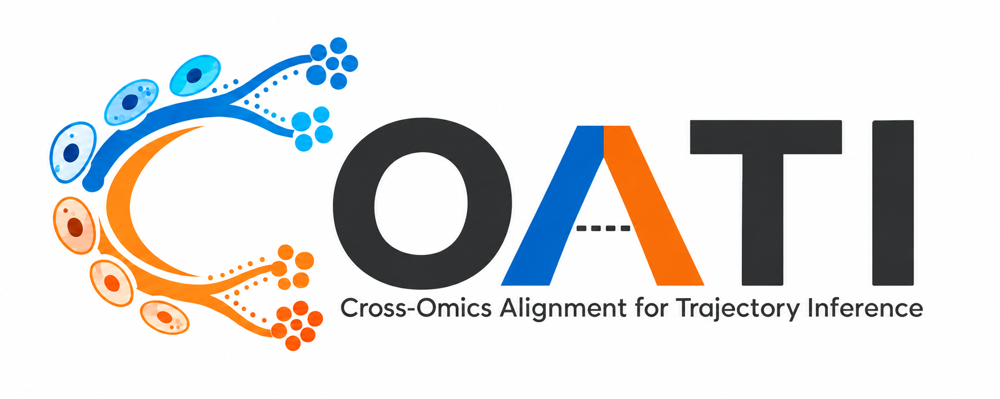

<p align="center"></p>

[Website](https://shankswang953.github.io/COATI/) · [Tutorials](https://shankswang953.github.io/COATI/tutorials.html)

# COATI

**Cross-Omics Aligned Trajectory Inference**

COATI learns continuous cell-state trajectories from time-indexed single-cell snapshots, with optional synchronization across RNA and ATAC modalities. It supports single- and multimodal inputs, balanced and unbalanced dynamics, and downstream trajectory analysis.

## Install

Use Python 3.10 or newer:

```bash
python -m pip install "coati-trajectory[notebooks,visualization] @ git+https://github.com/shankswang953/COATI.git"
```

The package is imported as `coati`. For local development and the notebooks:

```bash
git clone https://github.com/shankswang953/COATI.git
cd COATI
python -m pip install -e '.[notebooks,visualization]'
```

## Structure

```text
src/coati/     Python package and training engine
examples/      Standalone Python scripts
notebooks/     Executable tutorials
docs/          Website documentation source
tests/         Package tests
assets/        Logo and figures
```

## Notebooks

- [Introduction](notebooks/00_introduction.ipynb)
- [Original Gaussian experiment](notebooks/11_gaussian_reference.ipynb)
- [Gaussian toy: sync vs no sync](notebooks/01_gaussian.ipynb)
- [Splitting and growth](notebooks/03_split.ipynb)
- [Input formats](notebooks/04_inputs.ipynb)
- [Mouse gastrulation: data, training and UMAP](notebooks/10_gastrulation.ipynb)
- [Held-out biological reconstruction](notebooks/06_heldout_biological.ipynb)
- [Gastrulation dynamics and mass decomposition](notebooks/07_dynamics.ipynb)
- [Cross-modal map training and quality checks](notebooks/08_map_quality.ipynb)
- [Lineage gene and peak dynamics](notebooks/09_lineage_features.ipynb)

## TraInfBench

[TraInfBench](https://github.com/shankswang953/TraInfBench) hosts the external-method benchmark code used to compare COATI with CytoBridge, TrajectoryNet, MIOFlow, TIGON and scMultiNODE. It includes method-specific running instructions, evaluation and figure-analysis scripts, and dataset information.
