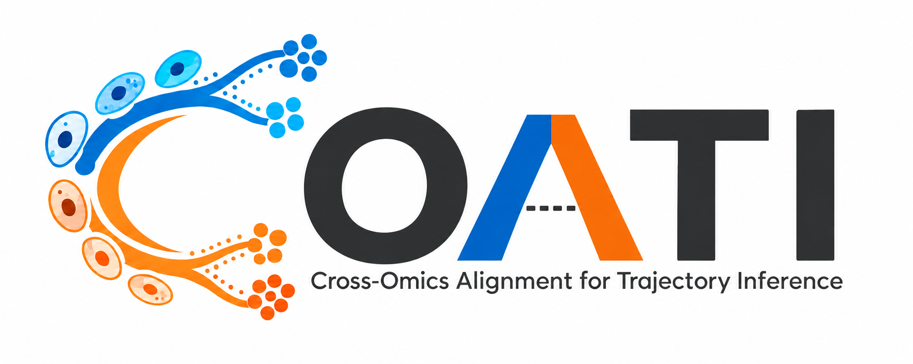
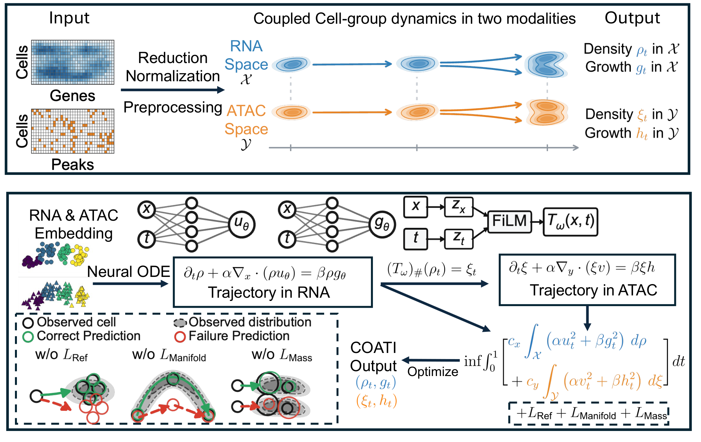

<p align="center"></p>

<p align="center"><a href="assets/coati-overview.pdf"></a></p>

[View overview PDF](assets/coati-overview.pdf) · [Watch the animated introduction](https://coati-trajectory-docs.shankswang.chatgpt.site/) · [Manim source](animations/)

# COATI

Cross-Omics Aligned Trajectory Inference. A portable Python interface around the TraInf neural dynamic optimal transport engine, with optional synchronized secondary-modality constraints.

## Install

```bash
python -m venv .venv
source .venv/bin/activate
python -m pip install -e '.[notebooks,docs,dev,visualization]'
```

Run these commands from this repository. The distribution name is `coati-trajectory`; import it as `coati`. This package is not yet published on PyPI.

## Train a vector field

```python
import coati as ct

# Single-modality, balanced training is the default.
data = ct.datasets.gaussian()
result = ct.train_vector_field(data, iterations=200)
trajectory = result.predict_trajectory()
velocity = result.compute_velocity()
result.plot_trajectory()
```

The two basic controls are `multimodal` and `balanced`. A paired run can use:

```python
config = ct.Config(multimodal=True, balanced=False,
                   iterations=500, learning_rate=1e-3, batch_size=64,
                   secondary_weight=0.35)
result = ct.train_vector_field(paired_data, config)
```

Explicit unbalanced mode supplies growth and count-based mass-matching defaults.
You can override every numerical setting. Existing `ct.fit`, `result.predict`,
`result.plot` and original engine parameter names remain supported.

## Velocity on an existing UMAP

```python
# adata uses the same X_pca features/preprocessing as the trained model.
ax = result.plot_velocity(adata, use_rep="X_pca", time_key="time",
                          color="cell_type", style="stream")
ax.figure.savefig("velocity_umap.pdf", bbox_inches="tight")

# Optional: explicitly store vectors in AnnData for downstream use.
result.write_velocity(adata, use_rep="X_pca", time_key="time")
# adata.obsm["coati_velocity"], adata.obsm["coati_velocity_umap"]
```

Use `style="arrows"`, `"grid"` or `"stream"`. Plotting reads the existing UMAP,
keeps AnnData row order and does not modify it. High-dimensional velocities are
projected by a local linear approximation; these are COATI model velocities in
an RNA-velocity-style visualization. See [velocity plotting](docs/velocity.md).

## Scripts and notebooks

```bash
python examples/run_toy.py --dataset gaussian --output outputs/gaussian
python examples/run_toy.py --dataset split --output outputs/split
python examples/run_toy.py --dataset paired --output outputs/paired
coati toy --dataset split --unbalanced --output outputs/unbalanced
python examples/run_velocity.py --multimodal --unbalanced --output outputs/velocity
python -m jupyterlab notebooks/
```

Each run directory must be new. Results include the resolved config, input snapshots, checkpoint, TensorBoard logs and metadata. CLI runs also write metrics and a trajectory figure.

- [01 · Gaussian translation](notebooks/01_gaussian.ipynb)
- [02 · Paired modalities](notebooks/02_paired.ipynb)
- [03 · Splitting and growth](notebooks/03_split.ipynb)
- [04 · Input formats](notebooks/04_inputs.ipynb)
- [05 · Vector fields and AnnData UMAP velocity](notebooks/05_velocity.ipynb)

## Your own data

```python
data = ct.TemporalData.from_npz(
    "primary.npz", secondary_path="secondary.npz",
    keys=["early", "middle", "late"], times=[0.0, 0.5, 1.0],
)
# Also: TemporalData(list_of_arrays, times), from_dict, from_csv,
# from_dataframe, from_anndata and from_h5ad.
```

Cross-modal inputs must be paired **within each snapshot**, including row identity and ordering. Across-time cells may be unpaired and counts may differ. Inputs are used as supplied: no hidden normalization, PCA or log transform.

## External-method benchmarks

[TraInfBench](https://github.com/shankswang953/TraInfBench) hosts the external-method portion of our benchmark comparison, including the code for running external methods and comparing them with COATI.

## Documentation

```bash
python -m sphinx -W --keep-going -b html docs docs/_build/html
python -m http.server 8000 --directory docs/_build/html
```

The documentation uses Sphinx + Furo and includes a Read the Docs configuration. See [migration](docs/migration.md) for the exact scope of the packaging changes and [validation](docs/validation.md) for verification results.

## Structure

```text
src/coati/           public data, config, training and result interfaces
src/coati/maps.py    automatic FiLM/MLP fitting, validation and checkpoints
src/coati/_core/     preserved research engine with package-relative imports
examples/           script entry point
notebooks/          executable cell-by-cell tutorials
tests/              data and training checks
scripts/            original-engine equivalence verification
docs/               Sphinx documentation source
provenance/         source hashes and validation records
assets/             supplied COATI logo
```

The original TraInf repositories are not dependencies and are not modified. Defaults are explicit toy-oriented choices; this release does not claim biological validation. Reference interface inspiration: [CytoBridge](https://github.com/zhenyiizhang/CytoBridge) and its [documentation](https://cytobridge.readthedocs.io/en/latest/index.html). No CytoBridge implementation is copied.
