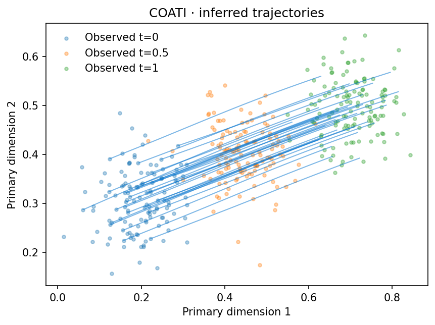

# Validation

Verified on 2026-09-10 using Python 3.10 on macOS ARM64, CPU, in a fresh isolated environment. No biological training was run.

The archived numerical results below used the earlier kernel-map default. They are not validation results for the new automatic FiLM default. Use `map_type="kernel"` when reproducing those runs. The automatic-map regression checks are in `tests/test_maps.py`, including stage exclusion, paired validation, quality warnings, frozen-map input gradients, normalization, user-provided maps and exact save/reload predictions.

On 2026-09-20, the default FiLM and time-independent MLP workflows were each run for 300 map epochs and 200 trajectory iterations on the paired toy with its middle stage omitted. Both completed without map-quality warnings and reproduced their primary and secondary predictions exactly after reload. The paired tutorial notebook was also executed with automatic FiLM fitting. These are CPU functional checks, not evidence of accuracy at held-out biological stages. The five original-engine equivalence checks were rerun with explicit kernel mapping and retained zero parameter differences.

## Biological temporal holdout

On 2026-10-12, [the pancreas reconstruction tutorial](tutorials/06_heldout_biological.ipynb)
was executed on paired RNA PCA50 / ATAC PoissonVI22 inputs. E15.5 (t = 1) was
excluded from both FiLM-map and vector-field fitting; E14.5 and E16.5 kept their
original times 0 and 2. The vector-field checkpoint records exactly 1,000
iterations, and RNA/ATAC predictions agreed after save/reload. The map passed its
within-retained-stage validation checks; this does not establish unseen-stage map accuracy.

The notebook includes shared UMAPs fitted only on retained observations and
representation-space distribution scores. Mean Sinkhorn reconstruction scores
were 0.3796 for RNA and 0.4914 for ATAC, versus 0.6399 and 0.7794 for the initial
distributions. The equal endpoint-mixture baseline scored 0.3904 and 0.4573,
so the short run did not beat that baseline in both modalities. These are one-seed
results with five subsampling repeats, not convergence or biological-superiority claims.
The existing all-data reduced representations and scalar normalization were fixed;
this is not an end-to-end raw-data holdout. The resolved settings and input hashes
are recorded in `provenance/heldout_pancreas_1000.json`.

The optional W2 scalar-normalization branch was also executed for 1,000
vector-field iterations, including checkpoint reload and shared UMAP projection.
Its RNA and ATAC scales were fitted only at times 0 and 2. Changing all held-out
values by a factor of 100 left both fitted scales unchanged, and converting the
working inputs back to their selected input units reproduced the source features.
The default branch retained identical reconstruction scores. Details are recorded
in `provenance/heldout_normalization_validation.json`.

## Original-engine equivalence

Same data, float32 precision, settings and seed in the original and packaged engines. The original device selector is overridden to CPU **only in the comparison harness**; its source files remain untouched.

| Mode | Iterations | Maximum parameter difference |
| --- | ---: | ---: |
| Balanced | 4 | 0 |
| Kernel synchronization | 4 | 0 |
| Unbalanced | 4 | 0 |
| Adaptive lambda | 4 | 0 |
| Synchronized, including gradient diagnostic | 100 | 0 |

The 100-step reference uses an enabled secondary density term, where the original diagnostic is defined. A separate regression check covers a disabled density term, which crashes the original diagnostic and is handled in the COATI copy. These checks establish equality for the tested cases, not every possible backend or experimental option.

## 200-step CPU toy runs

All use seed 0 and 128 initial cells. Endpoint Sinkhorn uses the original per-time median blur, evaluated on all endpoint samples. The floor was estimated with smaller training batches; it is context rather than an exact full-sample threshold.

| Example | Before transport | After transport | Kinetic energy |
| --- | ---: | ---: | ---: |
| gaussian | 0.147707 | 0.000455 | 0.139834 |
| split | 0.146521 | 0.003423 | 0.153955 |
| paired | 0.147707 | 0.000166 | 0.148672 |
| unbalanced | 0.146521 | 0.003776 | 0.001169 |

These arrays were not W2-normalized: kinetic energy need not be near one. Unbalanced energy is stored per particle with mass weights; the reported mean is not the total action. Its predicted total mass ratio is **0.9676**, versus an observed ratio of **2.0**. The short run verifies execution and geometric transport but has **not converged in mass**. Endpoint Sinkhorn is unweighted and should not be interpreted as a mass-aware unbalanced score.

## Interfaces and tutorials

- 12 regression checks passed: adapters, invalid input rejection, save/reload, normalization, secondary projection, accurate kernel and the 100-step disabled-loss diagnostic.
- All four notebooks executed cell by cell, including 200-step training and exact prediction reload checks.
- The Sphinx site builds with warnings treated as errors.
- Core source hashes and both original repositories' starting status are rechecked for preservation.

Machine-readable records are in `provenance/`: `equivalence.json`, `toy_metrics.json`, `notebook_execution.json`, and the tested package list. `scripts/verify_equivalence.py` reruns the read-only original comparison when a TraInf checkout is available.

## Scope

CPU results only. GPU/MPS, long biological training runs, full flow-matching pipelines and downstream molecular analyses have not been validated here. The toy checks and short biological holdout establish execution for these examples, not biological superiority.

## AnnData conventions and UMAP growth

On 2026-10-12, all 47 package checks passed after adding input preparation and
UMAP dynamics functions. Direct AnnData and TemporalData training produced
identical model parameters for the tested single- and multimodal unbalanced
examples. Analytic growth checks matched the saved ODE derivative, including its
`alpha_growth` multiplier. Tests covered metadata ambiguities, array conversion,
categorical time mappings, paired features, reordered cells, colors and labels,
copy-based storage and h5ad reload.

The unbalanced script ran for 300 iterations; the balanced script ran for 200.
Both produced a fitted UMAP, figure and stored vectors, with exact numerical
save/reload checks. The new dynamics notebook executed all six code cells.
Balanced results did not fabricate growth values. This validates the interfaces
and plotting behavior, not converged population mass or biological accuracy.
Records are in `provenance/anndata_dynamics_validation.json`. The training
algorithm under `src/coati/_core/` was not changed.
