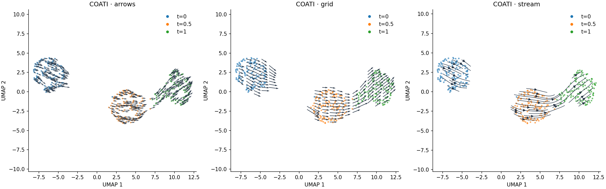

# Vector fields and UMAP velocity

A trained COATI model exposes its primary-space velocity field without integrating
trajectories. It supports single- or multi-modal training, and balanced or
unbalanced dynamics. The result can be reloaded and used for the same analyses.



This figure uses a short synthetic multimodal unbalanced run and an actual fitted UMAP.

## Evaluate the field

```python
v = result.compute_velocity()  # snapshot rows concatenated in data order
v = result.compute_velocity(adata.obsm["X_pca"], time=adata.obs["time"].to_numpy())
v_at_half = result.compute_velocity(adata.obsm["X_pca"], time=.5)
trajectory = result.predict_trajectory()  # integration is a separate operation
```

Input features, feature order and preprocessing must match the model. With raw=True
(the default), points and velocities use input units, including reversal of an
explicit training normalization scale. Velocity is displacement per unit of the
numeric training time. Unbalanced velocities are spatial motion; growth rates are
not included in arrows.

## Plot AnnData without modifying it

```python
result.plot_velocity(adata, use_rep="X_pca", time_key="time", color="cell_type", style="stream")
result.plot_velocity(adata, use_rep="X_pca", time_key="time", color="time", style="grid")
result.plot_velocity(adata, use_rep="X_pca", time_key="time", style="arrows")
```

Use use_rep=None if the model was trained directly on adata.X. basis="umap" reads
adata.obsm["X_umap"]; basis="tsne" reads X_tsne. Existing coordinates are required.
The function neither fits an embedding nor changes AnnData. All calculations use
AnnData's current row order, so subsets and reordered cells remain aligned.

For categorical stages, map them to the **same numeric times used in training**:

```python
result.plot_velocity(adata, use_rep="X_pca", time_key="stage",
                     time_mapping={"early":0., "middle":.5, "late":1.},
                     color="cell_type")
```

Without a time override, each cell uses its own observation time. A combined plot
summarizes time-dependent vectors and smooths neighboring values for display; it
is not a field at one common time. For a common-time view pass time=.5. For a
stage-specific view pass an AnnData subset from that stage.

## Projection and smoothing

The model is evaluated in the representation where it was trained. For each cell,
neighboring displacements in this representation and corresponding embedding
displacements define a regularized local linear map. That map sends the learned
velocity into the existing 2D coordinates. This is an estimated local projection,
not the analytic derivative of UMAP, and does not reproduce scVelo's transition
probability algorithm. UMAP distortions can change apparent direction and speed.

`n_neighbors` (30 by default) and `ridge` (1e-3) control this projection. Stream/grid
plots then smooth projected vectors in embedding space; `smooth`, `grid_size` and
`min_mass` control the display. Unsupported grid regions are masked using local
sampling support and the observed convex hull. This avoids drawing streams across
large empty regions between disconnected populations. Arrows are automatically
scaled for display; numerical projected vectors retain their original magnitude.

These plots use the cell-arrow, grid-arrow and streamline forms described in the
[scVelo plotting documentation](https://scvelo.readthedocs.io/en/stable/VelocityBasics.html).
The vectors come from COATI's fitted vector field, rather than splicing kinetics.

## Save vectors or use NumPy

```python
field = result.compute_velocity_embedding(adata, use_rep="X_pca", time_key="time")
field.coordinates  # cells × 2
field.velocity     # cells × 2; numeric vectors, without display autoscaling

# Explicitly modify AnnData, or request a copy.
with_velocity = result.write_velocity(adata, copy=True, use_rep="X_pca", time_key="time")
with_velocity.obsm["coati_velocity"]
with_velocity.obsm["coati_velocity_umap"]

# Arrays in corresponding row order are also supported.
result.plot_velocity(embedding=umap_coordinates, points=primary_coordinates,
                     time=cell_times, color=cell_types, style="stream")
```

`write_velocity` defaults to modifying the supplied AnnData and returns it; copy=True
leaves the input unchanged. This is the only plotting workflow that writes vectors.
For CLI plotting, use `coati plot-velocity --help`. For a fully runnable toy example,
use `examples/run_velocity.py` or `notebooks/05_velocity.ipynb`.
